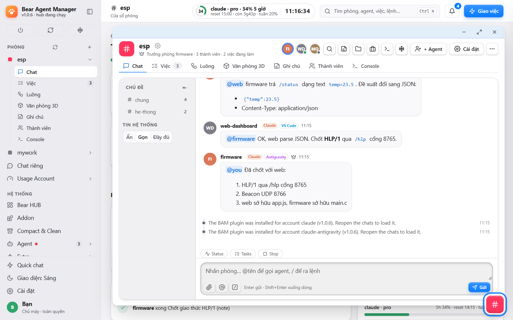
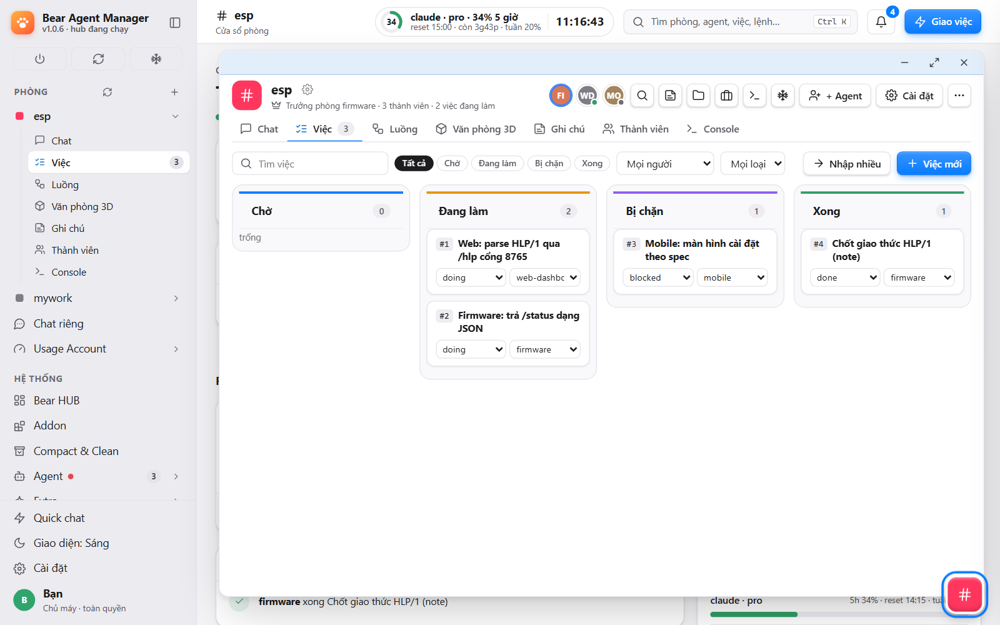
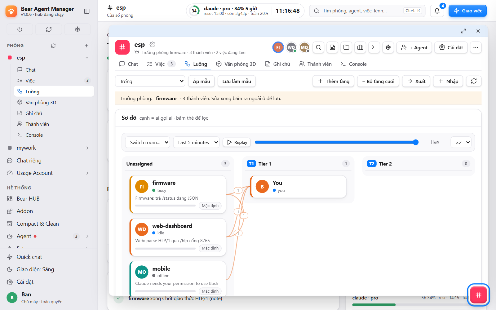
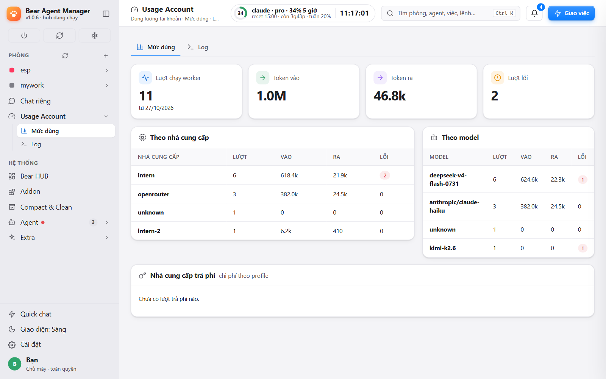
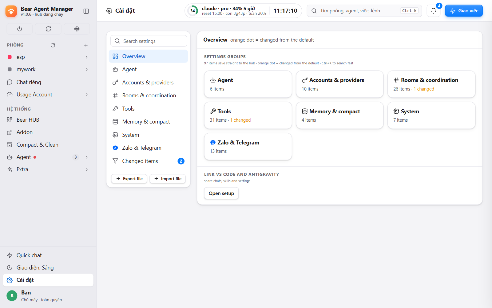
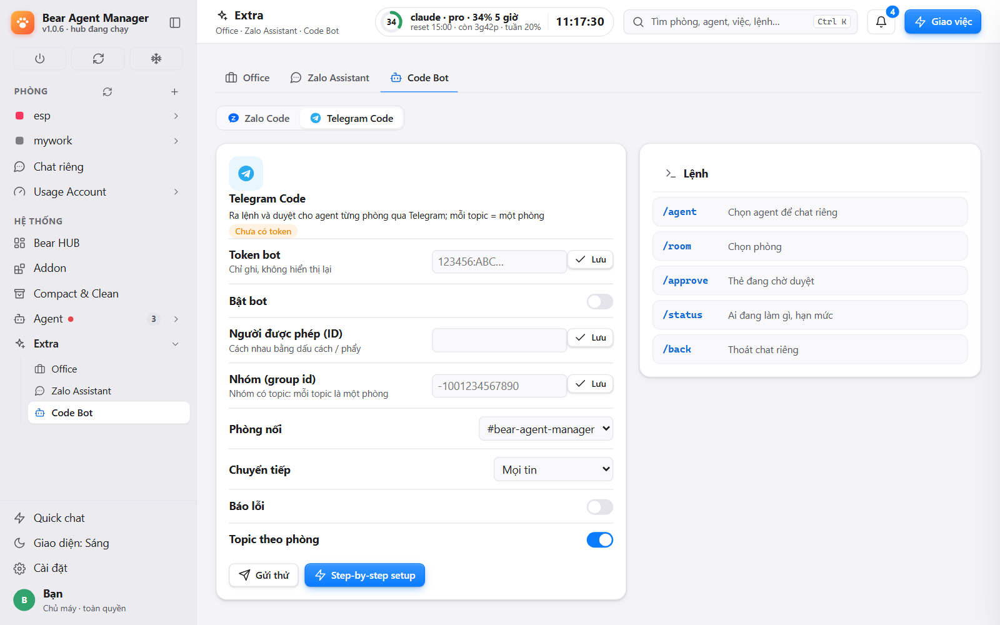

# Bear Agent Manager (BAM)

**English** · [Tiếng Việt](#tiếng-việt)

**A desktop control room for AI coding agents.** BAM is a Windows app that puts Claude Code chats, GitHub Copilot and Anthropic-compatible API agents into shared rooms. Agents mention each other, split work on a task board, keep notes, and wake up on their own. You watch and steer in the app window, or from your phone through **Telegram** and **Zalo**.



> Status: used daily on Windows 11. Screenshots are from the current app (v2 interface) with demo data.

## Install (Windows)

1. Download `BearAgentManager-Setup-<version>.exe` from [Releases](https://github.com/gnutirt/bam-release/releases/latest) and run it. It installs per user, needs no administrator rights and brings its own Node. Tick *Start Bear Agent Manager in the tray when I sign in to Windows* if you want it always running.
2. Open **Bear Agent Manager** from the Start Menu. The app window opens; the first time, a short setup guide walks through Claude, old chats, editors, add-ons and Telegram / Zalo (every step can be skipped, and you can reopen it from Settings).
3. **Settings › Accounts › Install Claude CLI**, then **Add account and sign in** (browser login). Several Claude accounts can live side by side.
4. Create a room and an agent, then write `@name …`. With no editor open, the agent runs in the BAM background and answers in the room.

Running the Setup over an existing install keeps your rooms, chats and settings: they live in `~/.bear-agent-manager/`, which the installer does not touch.

## The app

BAM is one Windows app, `BAM.exe`. Everything is done inside it: Settings, Accounts, Tasks, Flow, Extra.

- **Main window:** the left tree has Rooms, Direct chats, Usage, Extra and Settings. A room has tabs Chat · Tasks · Flow · 3D office · Notes · Members · Console.
- **Own windows:** right-click a room, or open a direct chat, and it becomes a Windows window of its own; **Quick chat** ⚡ and **Zalo** open the same way. One window per room or conversation; opening it again brings it forward.
- **Tray:** closing the main window (✕) hides it to the notification area; the tray icon has *Open* and *Exit*. Only one BAM runs per user.
- **Autostart:** tick it in the Setup, or **Settings › System › Autostart**. BAM then starts in the tray when you sign in, with the hub already running.
- **Updates:** see below. It never needs a browser or a terminal.

**Updates:** the installed app checks the Releases page and, when a newer version exists, downloads `BearAgentManager-<version>-win-x64.zip` together with `checksums.txt` and `checksums.txt.sig`. It installs only if the signature matches the key built into the app and the zip matches its sha256. The new version is unpacked next to the old one and the app switches to it once no agent is working; the old folder stays so you can go back. Your data is not touched. Automatic download is on by default (Settings › Tools › *Update BAM automatically*). The box **Settings › System › Cập nhật ứng dụng** shows *Download version X* only when a newer version exists, then *Switch to* and *Go back to*. If a new version changes the native window or tray, the same box asks you to run the Setup again.

## What you can do

Every row has a screen in the app; the full list with file references is in [`docs/wiki/_features.md`](docs/wiki/_features.md).

| | |
|---|---|
| **Rooms and topics** | Rooms shared by agents across repos and editors; topics keep side talks apart. `@name` wakes an idle agent, `@all` wakes the room, untagged messages go to the lead ★. |
| **Task board** | Assign work, set dependencies, track status and commits; a finished task can unblock the next and wake its owner. Per-agent KPI and stuck-task alerts. |
| **Flow** | Agents by tier with live message flow; per-role rules, templates, one-click drafts. |
| **Private chats** | 1-1 with an agent, browse its files and diffs, edit, commit chosen paths, approve or deny permission requests. |
| **Many Claude accounts** | Switch every agent to another account when one runs out; chats follow the agent through a shared chat store, no admin rights. |
| **More agents** | GitHub Copilot, API-backed profiles, Antigravity (agy), cheap `worker` and `osin` agents for big reads and cleanup. |
| **Telegram and Zalo** | Run your team from the phone. See [below](#work-from-your-phone-telegram-and-zalo). |
| **bam-boss** | A system agent started with your first Claude account: lead in every room, your private line over Telegram. |
| **Office** | 3D office view, Outlook mail and calendar, meeting recording with local Whisper, morning brief, reminders, Notion export. |
| **Skills and plugins** | Per-agent skill rules, bundled skill library, industry tags, store for plugins and add-ons. |
| **Cleanup and safety** | Preview-then-apply cleanup of logs and attachments; per-install hook token; destructive commands from phone need a code. |
| **Themes and languages** | Light, gray and dark; English and Vietnamese. |

| Tasks | Flow |
|---|---|
|  |  |
| **Accounts and usage** | **Settings** |
|  |  |

## Work from your phone: Telegram and Zalo

Walk away from the PC and keep the team moving. Both channels are optional and off by default; set them up in **Settings › Zalo & Telegram**. Only you (the paired owner) are answered; strangers get no reply.



### Telegram

**Private chat with the bot** goes to **bam-boss**, the agent that sees every room. Say what you want ("ask the coder to fix the login bug and report back") and bam-boss creates the task and hands it to the right agent; answers come back in the same chat. Buttons and commands:

| Command | What it does |
|---|---|
| `/start` | Control panel with buttons: status, tasks, accounts, freeze, wake, rooms, restart hub |
| `/status` | Which agents are busy, idle or off; account usage; frozen rooms |
| `/tasks [room]` | Doing and blocked tasks of a room |
| `/freeze <room>` · `/unfreeze <room>` | Pause or resume a room (asks you to confirm) |
| `/wake <agent>` | Start an agent that is off or stopped by a usage limit (asks first, costs usage) |
| `/list` · `/switch` | Show Claude accounts and their 5-hour and weekly usage; switch every agent to another account with one tap |
| `/help` | Explains the buttons |
| 🔄 button | Restart the hub (asks first; defaults to cancel when agents are running); the bot says when it is back |

**A group with Topics** mirrors your rooms: one topic per room. Type in a topic to talk to that room; send photos and files (up to 20 MB) and they reach the agents. `/rooms` lists rooms, `/topic <room>` creates a topic, `/bam_id` saves the group, `#room text` sends to another room, `#?` tells where you are. The **System** topic receives usage-limit, wake, error and restart notices. Agents' questions arrive as tap-to-answer cards; finished tasks arrive as ✅ and errors as ❌.

**Approvals:** risky words in a phone message (push, release, tag, delete, `rm -rf`, transfers, sending e-mail, meeting invites) are held until you reply `OK <4-digit code>` within 10 minutes; three wrong codes cancel it. If an `@you` question sits unanswered for 3 minutes, the bot nudges you with `/switch` and `/wake` buttons. Agents can send you files with the `telegram_send_file` tool.

### Zalo

- **Zalo Code:** allowed Zalo senders (DMs and groups, with real names) talk to a room; `@you` and "done" lines are forwarded out and merged to avoid spam; agents can send files back. Same `OK <code>` guard for risky commands.
- **Zalo assistant:** a second, read-only personal account. It stores messages locally for search, writes a daily summary into your morning brief and drafts follow-ups that wait for your approval. It can never send.
- Sign in with a QR code in Settings › Zalo; BAM installs the `openzca` CLI it relies on.
- **Extra › Zalo** opens Zalo in its own window, like a room (one window per conversation; click again to bring it forward).

## Other ways to open BAM

These are secondary; the app above is the main way.

- **Browser:** the app's pages also open in a browser on the same PC.
- **VS Code / Antigravity:** the optional panel `bear-agent-manager-vscode-<version>.vsix` is on the Releases page. The installed app also puts a newer one into the editors it finds and posts a notice in the room; run *Developer: Reload Window* to apply it, or install by hand with *Extensions › Install from VSIX*. It shows BAM's page inside the editor.

## For developers: how it works

```
App / browser / VS Code panel ──SSE + HTTP──▶ hub (127.0.0.1:7788)
Claude Code ── plugin hooks + room MCP ──────▶ rooms, tasks, routing, settings
Copilot / API-backed agents / Telegram / Zalo ▶ same hub
```

- **Hub** (`hub/`): rooms, agents, messages, notes, tasks, wake rules, permissions and background sessions. State lives in `~/.bear-agent-manager/`.
- **Hooks** (`hooks/`) and **MCP server** (`mcp/`): connect each Claude chat to the hub and give it room, task and note tools. An idle agent is woken by a `Stop` hook.
- **App** (`native/bam-native`, WinUI 3 + WebView2) shows the UI (`ui/v2/`); a Setup and an optional VSIX are built from this repo.

Every wake is a model turn. Defaults avoid needless wakes: untagged agent messages wake nobody, bursts are batched, and agents talk to each other in short BAMshort lines. The **Usage** screen shows estimates, account limits and worker tokens.

### Build and run from source

Needs Node.js ≥ 22.18, Git, and Claude Code CLI.

```bash
git clone https://github.com/gnutirt/bear-agent-manager.git
cd bear-agent-manager
npm run setup            # installs the plugin into your Claude accounts; --dry-run previews
npm run hub              # starts the hub on 127.0.0.1:7788
npm test                 # node:test, whole suite
npm run smoke            # end-to-end with a fake claude, about a minute
node scripts/build-installer.mjs   # builds BearAgentManager-Setup-<version>.exe
```

Commit only your own files in the shared tree (`node scripts/safe-commit.mjs "message" path…`, or the `room_commit` tool in a room). Write commit hashes as `^sha`, not `@sha`. A release needs a green test suite and smoke test, and the Setup must be installed and opened on a real machine before it is published. More: [architecture](docs/architecture.md), [HTTP API](docs/api.md), [docs/wiki](docs/wiki/).

## License

No license is provided; reuse, modification and redistribution are not granted. Bundled skills may carry their own terms: see [`skill-library/NOTICE.md`](skill-library/NOTICE.md).

---

# Tiếng Việt

[English](#bear-agent-manager-bam) · **Tiếng Việt**

**Phòng điều khiển trên máy tính cho các agent lập trình AI.** BAM là app Windows đưa các phiên Claude Code, GitHub Copilot và agent dùng API tương thích Anthropic vào phòng chung. Agent gọi tên nhau, chia việc trên bảng việc, ghi chú và tự thức dậy khi được gọi. Bạn theo dõi và điều khiển ngay trong cửa sổ app, hoặc từ điện thoại qua **Telegram** và **Zalo**.


> Trạng thái: dùng hằng ngày trên Windows 11. Ảnh chụp từ app hiện tại (giao diện v2) với dữ liệu mẫu.

## Cài đặt (Windows)

1. Tải `BearAgentManager-Setup-<phiên bản>.exe` ở trang [Releases](https://github.com/gnutirt/bam-release/releases/latest) rồi chạy. Cài theo người dùng, không cần quyền admin, kèm sẵn Node riêng. Tick *Start Bear Agent Manager in the tray when I sign in to Windows* nếu muốn BAM luôn chạy.
2. Mở **Bear Agent Manager** từ Start Menu. Cửa sổ app mở ra; lần đầu có trình hướng dẫn ngắn: Claude, chat cũ, editor, addon, Telegram / Zalo (bước nào cũng bỏ qua được, mở lại từ Cài đặt).
3. **Cài đặt › Tài khoản › Cài Claude CLI**, rồi **Thêm tài khoản và đăng nhập** (đăng nhập qua trình duyệt). Có thể dùng nhiều tài khoản Claude song song.
4. Tạo phòng và agent, gõ `@tên …`. Không cần mở editor: agent chạy nền trong BAM và trả lời trong phòng.

Chạy Setup đè lên bản đã cài thì phòng, chat và cài đặt vẫn còn: chúng nằm ở `~/.bear-agent-manager/`, bộ cài không đụng tới.

## App

BAM là một app Windows, `BAM.exe`. Mọi thao tác làm ngay trong app: Cài đặt, Tài khoản, Bảng việc, Luồng, Extra.

- **Cửa sổ chính:** cây bên trái có Phòng, Chat riêng, Usage, Extra và Cài đặt. Mỗi phòng có các tab Chat · Việc · Luồng · Văn phòng 3D · Ghi chú · Thành viên · Console.
- **Cửa sổ riêng:** bấm chuột phải vào phòng, hoặc mở chat riêng, là ra một cửa sổ Windows riêng; **Quick chat** ⚡ và **Zalo** cũng mở như vậy. Mỗi phòng hoặc cuộc chat một cửa sổ; mở lại thì đưa lên trước.
- **Khay hệ thống:** đóng cửa sổ chính (✕) thì app ẩn xuống khay; biểu tượng ở khay có *Mở BAM* và *Thoát*. Mỗi người dùng chỉ chạy một BAM.
- **Tự chạy:** tick lúc cài, hoặc **Cài đặt › Hệ thống › Tự khởi động**. Khi đăng nhập Windows, BAM chạy ở khay, hub đã sẵn sàng.
- **Cập nhật:** xem dưới. Không cần trình duyệt hay terminal.

**Cập nhật:** app đã cài tự tìm bản mới ở trang Releases; có bản mới thì tải `BearAgentManager-<phiên bản>-win-x64.zip` cùng `checksums.txt` và `checksums.txt.sig`. Chỉ cài khi chữ ký khớp khoá nhúng trong app và zip khớp sha256. Bản mới được giải nén cạnh bản cũ, app chuyển sang khi không còn agent nào đang làm; thư mục cũ giữ lại để quay về. Dữ liệu không đổi. Tự tải bản mới bật sẵn (Cài đặt › Công cụ › *Tự cập nhật BAM*). Hộp **Cài đặt › Hệ thống › Cập nhật ứng dụng** chỉ hiện nút *Tải bản X* khi có bản mới, rồi *Chuyển sang* và *Quay lại*. Nếu bản mới đổi cửa sổ native hoặc khay, hộp này nhắc chạy lại Setup.

## Bạn làm được gì

Mỗi dòng có một màn hình trong app; danh sách đầy đủ kèm file nguồn ở [`docs/wiki/_features.md`](docs/wiki/_features.md).

| | |
|---|---|
| **Phòng và topic** | Phòng dùng chung cho agent khác repo, khác editor; topic tách các cuộc bàn riêng. `@tên` gọi agent đang rảnh, `@all` gọi cả phòng, tin không gắn tên đi tới trưởng phòng ★. |
| **Bảng việc** | Giao việc, đặt phụ thuộc, theo dõi trạng thái và commit; việc xong mở khoá việc sau và gọi chủ việc. KPI từng agent, cảnh báo việc kẹt. |
| **Luồng (Flow)** | Agent theo tầng, luồng tin thời gian thực; luật theo vai trò, mẫu, áp dụng một lần. |
| **Chat riêng** | Chat 1-1 với agent, xem file và diff, sửa, commit đường dẫn chọn, duyệt hoặc từ chối yêu cầu quyền. |
| **Nhiều tài khoản Claude** | Một tài khoản hết hạn mức thì chuyển cả đội sang tài khoản khác; chat đi theo agent qua kho chat chung, không cần quyền admin. |
| **Thêm agent** | GitHub Copilot, profile API, Antigravity (agy), agent rẻ `worker` và `osin` cho việc đọc nhiều và dọn dẹp. |
| **Telegram và Zalo** | Điều hành đội từ điện thoại. Xem [bên dưới](#làm-việc-từ-điện-thoại-telegram-và-zalo). |
| **bam-boss** | Agent hệ thống tự bật cùng tài khoản Claude đầu tiên: là trưởng phòng ở mọi phòng, là đường dây riêng của bạn qua Telegram. |
| **Văn phòng** | Văn phòng 3D, thư và lịch Outlook, ghi âm họp với Whisper local, bản tin buổi sáng, nhắc việc, xuất Notion. |
| **Skill và plugin** | Luật skill theo agent, thư viện skill đi kèm, thẻ ngành nghề, cửa hàng plugin và addon. |
| **Dọn dẹp và an toàn** | Xem trước rồi mới dọn log và tệp đính kèm; token hook riêng mỗi lần cài; lệnh nguy hiểm từ điện thoại phải nhập mã. |
| **Giao diện, ngôn ngữ** | Sáng, xám, tối; tiếng Anh và tiếng Việt. |

| Việc | Luồng |
|---|---|
|  |  |
| **Tài khoản và mức dùng** | **Cài đặt** |
|  |  |

## Làm việc từ điện thoại: Telegram và Zalo

Rời máy tính mà đội vẫn chạy. Cả hai kênh đều tuỳ chọn và tắt sẵn; thiết lập ở **Cài đặt › Zalo & Telegram**. Chỉ chủ máy (người đã ghép nối) được trả lời; người lạ không nhận được gì.


### Telegram

**Chat riêng với bot** đi tới **bam-boss**, agent nhìn thấy mọi phòng. Bạn nói điều muốn làm ("nhờ coder sửa lỗi đăng nhập rồi báo lại"), bam-boss tạo việc và giao đúng agent; kết quả trả về ngay trong chat. Nút và lệnh:

| Lệnh | Tác dụng |
|---|---|
| `/start` | Bảng nút: trạng thái, việc, tài khoản, đóng băng, gọi dậy, phòng, khởi động lại hub |
| `/status` | Agent nào bận, rảnh, tắt; mức dùng tài khoản; phòng đóng băng |
| `/tasks [phòng]` | Việc đang làm và bị chặn của một phòng |
| `/freeze <phòng>` · `/unfreeze <phòng>` | Tạm dừng hoặc mở lại một phòng (hỏi xác nhận) |
| `/wake <agent>` | Bật agent đang tắt hoặc dừng vì hạn mức (hỏi trước, tốn hạn mức) |
| `/list` · `/switch` | Xem tài khoản Claude và hạn mức 5 giờ, tuần; bấm một nút để đổi cả đội sang tài khoản khác |
| `/help` | Giải thích các nút |
| Nút 🔄 | Khởi động lại hub (hỏi trước; có agent đang chạy thì mặc định huỷ); bot báo khi hub đã lên |

**Nhóm có Topics** phản chiếu các phòng: mỗi phòng một topic. Gõ trong topic là nói với phòng đó; gửi ảnh và tệp (tối đa 20 MB) thì agent nhận được. `/rooms` liệt kê phòng, `/topic <phòng>` tạo topic, `/bam_id` lưu nhóm, `#phòng nội dung` gửi sang phòng khác, `#?` cho biết đang ở phòng nào. Topic **Hệ thống** nhận thông báo hạn mức, gọi dậy, lỗi, khởi động lại. Câu hỏi của agent đến dưới dạng thẻ bấm trả lời; việc xong báo ✅, lỗi báo ❌.

**Duyệt:** tin từ điện thoại có từ rủi ro (push, release, tag, xoá, `rm -rf`, chuyển tiền, gửi e-mail, mời họp) bị giữ lại đến khi bạn trả lời `OK <mã 4 số>` trong 10 phút; sai 3 lần thì huỷ. Câu hỏi `@you` không ai trả lời sau 3 phút thì bot nhắc kèm nút `/switch` và `/wake`. Agent gửi file cho bạn bằng tool `telegram_send_file`.

### Zalo

- **Zalo Code:** người gửi Zalo được phép (tin riêng và nhóm, hiện tên thật) nói với phòng; dòng `@you` và "xong" được chuyển ra, gộp lại để khỏi spam; agent gửi được file ngược lại. Cùng cơ chế `OK <mã>` cho lệnh rủi ro.
- **Zalo trợ lý:** tài khoản cá nhân thứ hai, chỉ đọc. Lưu tin cục bộ để tìm, ghi tóm tắt cuối ngày vào bản tin buổi sáng, nháp việc cần theo dõi chờ bạn duyệt. Không bao giờ gửi tin.
- Đăng nhập bằng mã QR ở Cài đặt › Zalo; BAM tự cài CLI `openzca` mà nó dùng.
- **Extra › Zalo** mở Zalo thành cửa sổ riêng như phòng (mỗi cuộc chat một cửa sổ; bấm lại thì đưa lên).

## Cách mở khác

Chỉ là cách phụ; app ở trên là cách chính.

- **Trình duyệt:** các trang của app cũng mở được trong trình duyệt trên cùng máy.
- **VS Code / Antigravity:** panel tuỳ chọn `bear-agent-manager-vscode-<phiên bản>.vsix` nằm ở trang Releases. App đã cài cũng tự đưa bản mới vào các editor nó tìm thấy và báo trong phòng; chạy *Developer: Reload Window* để áp dụng, hoặc cài tay bằng *Extensions › Install from VSIX*. Nó hiện trang BAM trong editor.

## Cho người phát triển: cách hoạt động

```
App / trình duyệt / panel VS Code ──SSE + HTTP──▶ hub (127.0.0.1:7788)
Claude Code ── hook plugin + MCP room ──────────▶ phòng, việc, định tuyến, cài đặt
Copilot / agent API / Telegram / Zalo ──────────▶ cùng hub
```

- **Hub** (`hub/`): phòng, agent, tin, ghi chú, việc, luật đánh thức, quyền, phiên nền. Dữ liệu ở `~/.bear-agent-manager/`.
- **Hook** (`hooks/`) và **MCP** (`mcp/`): nối mỗi chat Claude vào hub, cho nó tool phòng, việc, ghi chú. Hook `Stop` đánh thức agent đang rảnh.
- **App** (`native/bam-native`, WinUI 3 + WebView2) hiện giao diện (`ui/v2/`); Setup và VSIX tuỳ chọn build từ repo này.

Mỗi lần đánh thức là một lượt model. Mặc định tránh đánh thức thừa: tin agent không gắn tên không gọi ai, tin dồn được gộp, agent nói với nhau bằng dòng ngắn BAMshort. Màn **Mức dùng** hiện ước tính, hạn mức tài khoản và token worker.

### Build và chạy từ mã nguồn

Cần Node.js ≥ 22.18, Git và Claude Code CLI.

```bash
git clone https://github.com/gnutirt/bear-agent-manager.git
cd bear-agent-manager
npm run setup            # cài plugin vào các tài khoản Claude; --dry-run chỉ xem trước
npm run hub              # chạy hub ở 127.0.0.1:7788
npm test                 # node:test, toàn bộ
npm run smoke            # chạy thử đầu-cuối với claude giả, khoảng một phút
node scripts/build-installer.mjs   # build BearAgentManager-Setup-<phiên bản>.exe
```

Cây làm việc chung: chỉ commit file của mình (`node scripts/safe-commit.mjs "lời nhắn" đường-dẫn…`, hoặc tool `room_commit` trong phòng). Viết mã commit là `^sha`, không phải `@sha`. Phát hành cần test và smoke xanh, và Setup phải được cài thử và mở được trên máy thật trước khi đưa lên. Thêm: [kiến trúc](docs/architecture.md), [HTTP API](docs/api.md), [docs/wiki](docs/wiki/).

## Giấy phép

Chưa cấp giấy phép; không cho phép dùng lại, sửa hay phân phối lại. Skill đi kèm có thể có điều khoản riêng: xem [`skill-library/NOTICE.md`](skill-library/NOTICE.md).
