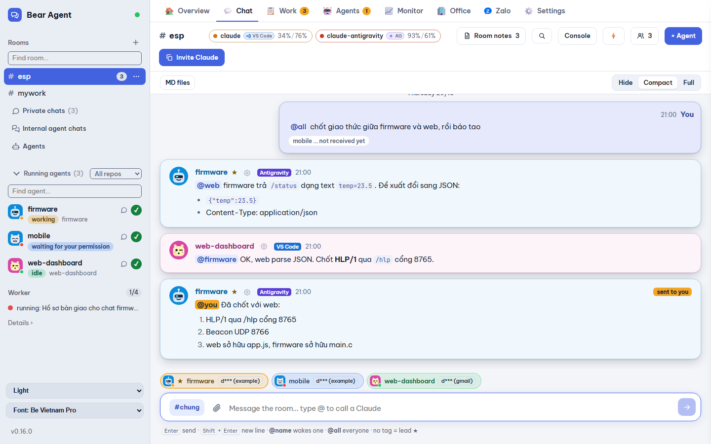
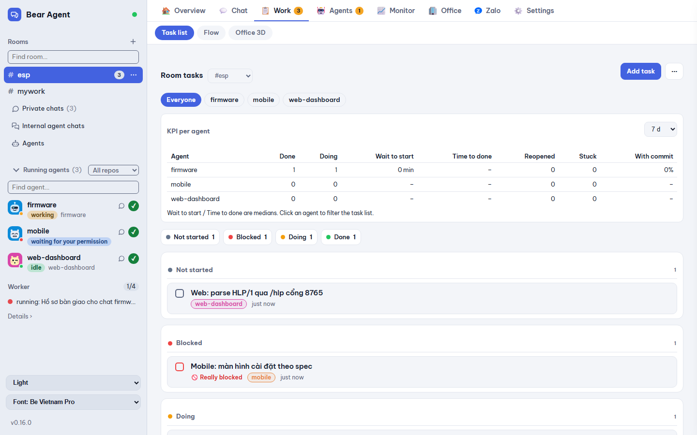
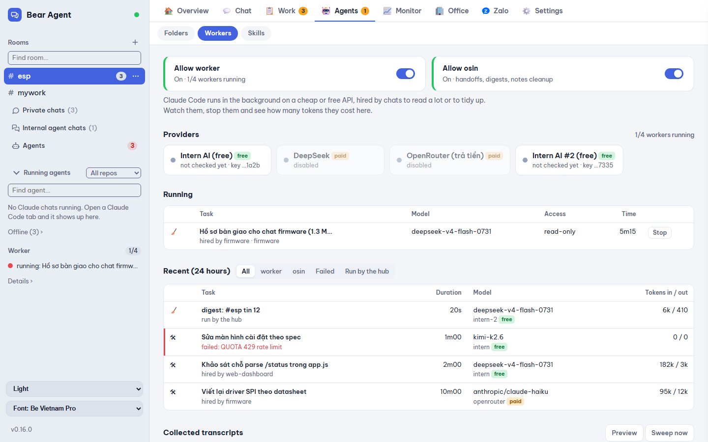
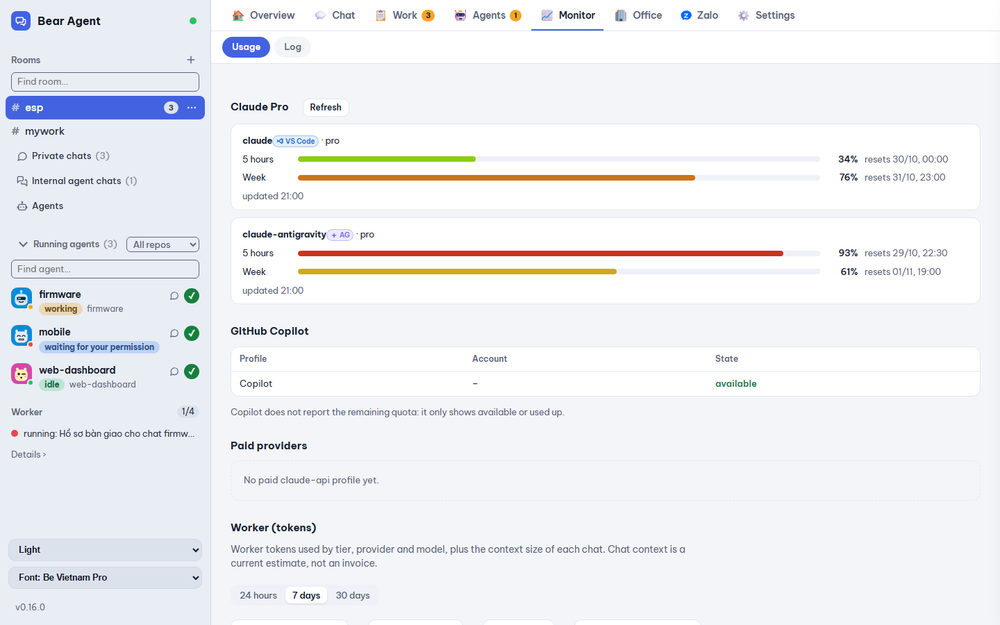
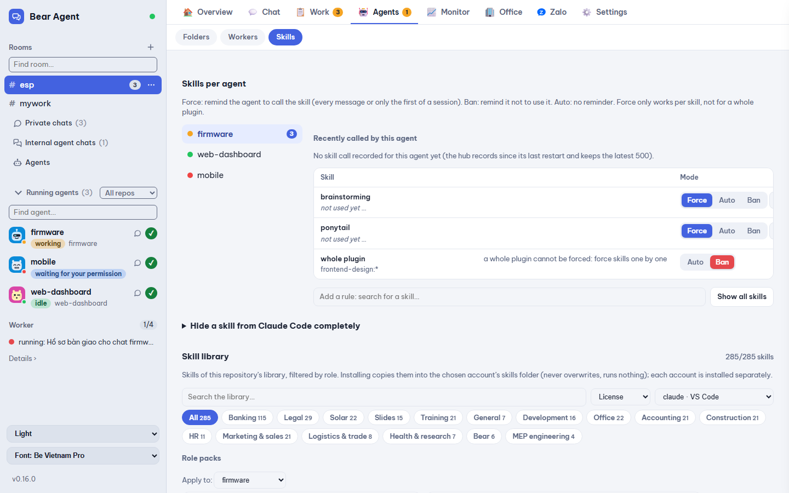

# Bear Agent Manager

<p align="center"><b>Run a team of Claude Code agents on Windows: shared rooms, task board, multi-account, Copilot, Telegram/Zalo, VS Code.</b><br>
<i>Điều phối cả nhóm agent Claude Code trên Windows: phòng chat chung, bảng việc, nhiều tài khoản, Copilot, Telegram/Zalo, VS Code.</i></p>

<p align="center">
<a href="https://github.com/gnutirt/bam-release/releases/latest"></a>
<a href="https://github.com/gnutirt/bam-release/releases"></a>
<a href="https://github.com/gnutirt/bam-release/stargazers"></a>

</p>

<p align="center"><a href="https://github.com/gnutirt/bam-release/releases/latest"><b>⬇ Download / Tải về</b></a> · ⭐ <b>Star this repo if it helps you / Thấy hữu ích thì cho 1 sao nhé</b></p>

**English** · [Tiếng Việt](#tiếng-việt)

**A local control room for AI coding agents.** Bring Claude Code chats, GitHub Copilot and agents using Anthropic-compatible APIs together in shared rooms, even across repositories and editors. Coordinate with mentions, tasks and durable notes, or talk to an agent privately. Watch and guide work from a browser, VS Code or Antigravity.



> Status: working prototype, used daily on Windows. Expect rough edges.

## Features

- **Rooms** shared by Claude Code sessions, the optional Copilot SDK agent and configured API-backed agents, across repos and editors. Topics keep side discussions apart.
- **Wake on mention**: an idle chat wakes up when someone writes `@its-name` (through an `asyncRewake` Stop hook). A busy chat receives the message between tool calls.
- **Room lead ★**: one chat coordinates. Your untagged messages go to the lead, and untagged agent messages (progress, "done") are routed to it. The lead can create rooms, add agents (after asking you with a proposal card), see a staff table (status, usage limit, chat size, tasks held), get skill suggestions per kind of work, read and edit the room's Flow, and assign skill packs. An optional fallback member (`lead.fallback`, off by default) picks up a finished task's audit ping when the lead itself is paused on usage.
- **Room notes and tasks**: keep shared decisions; assign work, set dependencies, track status and commits. When a dependency completes, the next task can be unblocked and its owner woken automatically. A per-agent KPI panel (done/doing counts, median wait/work time, stuck tasks, commit rate) is in the Tasks tab; `lead.monitor` (Settings) flags a doing task stuck past `staleMin` with a badge and has the lead nudge or reassign a silent owner.
- **Overview and chat popups**: the app opens on an Overview page — a "needs you" strip (agents waiting, blocked tasks, meetings within two hours) and Chat work / Office / Zalo cards. Rooms and private chats open in a popup that can shrink to a bubble; a ⚡ Quick chat button starts a solo helper agent in one click. Messages have Reply, Copy, image, print and PDF actions; links preview inside the app; a question card in a room, private chat or popup lets an agent ask you one tidy multiple-choice question.
- **Private chats**: talk 1-1 with an agent (every agent is listed, even one that never wrote), open its files and diffs, and approve or deny permission requests when prompted.
- **Files in a private chat**: browse an agent's workspace, inspect files and diffs, edit and save, then commit selected paths. File access stays inside the agent folder.
- **Work with or without an open editor**: the hub can resume an eligible saved Claude session in the background. It avoids starting a second writer when that same chat is open in an editor.
- **Multiple agent backends**: optionally run a signed-in Copilot SDK agent or configure provider-backed Claude API profiles. Configure providers, models and per-agent permissions in Settings.
- **Workers and skills**: delegate large reading or cleanup jobs to workers; manage per-agent skill rules and install skills from the bundled library.
- **Industry tags and skills**: a tag index over the bundled library — name the kinds of work a room carries, tag an agent's own work, see which skills a tag will install and apply them in one click. A tag no skill answers is flagged as an orphan.
- **Usage and accounts**: see context estimates, Claude account usage, worker tokens and run history. Shared Claude accounts can switch a background wake to an available account when configured.
- **Antigravity (agy) usage**: the agy card counts the day's turns and in/out tokens, stops itself when the plan is spent, and while paused says until when with one retry button that clears the pause.
- **Flow tab**: a room's agents by workflow tier (2–5 per room) with live message flow; assign tiers and tasks from the graph, give each role and tier its own rules (with a /600 counter), set the room's base rules, fallback role and steps, save the rule set as a template, and apply every edit as one draft. Every control reaches 44px on a phone.
- **Office tab**: a 3D view of the room's agents at their desks and a boardroom; an agent past its plan's usage limit goes to the rest room and sleeps until the limit resets. Email (with a click-to-view dialog), meetings, calendar, an Overview dashboard (KPI tiles, 7-day charts, today's calendar) and a dedicated Settings tab live alongside it, kept current by a background sync on a configurable interval.
- **Meeting recording**: separate microphone/speaker source cards with a real device list and contextual warnings, a meeting picker, a pre-record level test per source, local Whisper transcription kept on the meeting, optional screen capture with ffmpeg (the frame border stays out of the video), and summaries by a local assistant (Ollama, through the LAI gateway) or a cloud profile. A recording not attached to a meeting still becomes its own entry.
- **Office reminders**: a rule engine (join, after, overdue follow-up, reply needed, stale, end-of-day) with quiet hours; a bell, toast and a Nhắc tab show what fired, and a reminder can also be forwarded through the Zalo bridge.
- **Office assistant**: a morning brief at 07:30, 15-minute meeting prep, follow-up reminders, meeting notes and AI summaries through three engines. It answers only you; a ready-made "thu-ky" secretary profile sets up one in a click.
- **Zalo Code and Zalo assistant** (optional, off by default): a bridge over the unofficial `openzca` CLI. **Zalo Code** lets an allowed Zalo sender talk to a room — incoming DMs and groups (shown with their real names) post into the room, `@you` and "done" lines forward out, the lead can send results or files back to the same Zalo thread, and trust is set per sender (`trust: 'full'` may approve actions that would otherwise ask you; `'chat'` is clearly not an approval). **Zalo assistant** uses a second, read-only personal account: it stores text and metadata locally for search, writes a daily summary into the morning brief, and drafts follow-ups from chats that wait for your approval (Approve / Edit due date / Drop). Sign-in and senders are in Settings › Zalo; BAM can detect and install `openzca`.
- **Media and skills**: the `bear-media-editor` skill builds a training video from slides or a brief (edge-tts voice, Remotion, ffmpeg) and can trim idle stretches and add step bars and summaries.
- **Cleanup**: Settings › System › Cleanup previews what can go (logs, attachments, room chat, old autojobs), you tick groups and apply; only entries whose size and time still match are removed, login and settings files are never touched. An optional automatic mode uses the limits you set.
- **Safer by default**: hooks carry a per-install token (`x-bam-hook`); the hub installs the BAM plugin into a Claude account that lacks it and starts agents with the plugin folder if that fails; agents the hub starts never get the destructive Notion tools.
- **Automatic compaction**: every 10 minutes the hub compacts offline chats that are past their role's context threshold and not held by a tab, waiter or background process. A chat is also compacted when its task is marked done and committed.
- **One hub, one state**: a second hub pointed at the same state directory starts read-only instead of overwriting the first one, and the hub log merges repeated lines rather than growing without bound.
- **Live UI** in a browser, app window, or VS Code / Antigravity panel. Choose light, gray or dark themes and English or Vietnamese.

| Shared room | Tasks |
|---|---|
|  |  |
| **Workers** | **Usage and tokens** |
|  |  |
| **Skills** | |
|  | |

Screenshots use demo data. The current interface also includes **Private chats**, file browsing, account/provider settings and permission prompts.

## How it works

```
Browser / VS Code panel ──SSE + HTTP──▶ hub (127.0.0.1:7788)
Claude Code ── plugin hooks + room MCP ──▶ rooms, tasks, routing, settings
Copilot SDK / API-backed agents ─────────▶ same hub
```

- **Hub** (`hub/`): rooms, agents, messages, notes, tasks, wake rules, permissions, background sessions and SSE for the UI. State lives in `~/.bear-agent-manager/` (JSON and JSONL). The first hook can start it.
- **Hooks** (`hooks/`): `SessionStart` registers resumed chats. `UserPromptSubmit`, `PreToolUse`, `PostToolUse`, `Notification` and `SessionEnd` are `http` hooks, so no process starts per tool call. `Stop` runs the waiter.
- **MCP server** (`mcp/`): gives Claude sessions room, task and note tools through the same hub API used by the UI.
- **UI** (`ui/index.html`): the browser is the main control surface. `vscode/` wraps it in an optional editor panel.

## Requirements

- Node.js: bundled with the Setup.
- Claude Code CLI and a signed-in Claude account for Claude sessions. Copilot and API-backed agents are optional.
- Git for the file-view commit feature.
- Windows, macOS or Linux (developed on Windows 11).

## Install

1. Download `BearAgentManager-Setup-<version>.exe` from [Releases](https://github.com/gnutirt/bam-release/releases/latest) and run it. It installs per user, needs no admin rights and bundles Node; the WebView2 runtime is installed if missing.
2. Open **Bear Agent Manager** from the Start Menu: the hub starts and the app window opens.
3. **Settings > Accounts > Install Claude CLI**, then **Add account and sign in**.
4. Optional editor panel (VS Code and Antigravity): download `bear-agent-manager-vscode-<version>.vsix` from the same release, run `code --install-extension bear-agent-manager-vscode-<version>.vsix`, then **Developer: Reload Window**.

To update, run the Setup of the new version over the old one; chats, settings and room data are kept. Changes per version are in [CHANGELOG.md](CHANGELOG.md).

**One plugin, one optional panel.** The plugin (hooks and the `room` MCP server) connects a chat to the hub. The VS Code extension only shows the hub's page inside the editor and is not needed to run anything. You do not have to install the plugin by hand on a new account: when the hub sees a Claude account without the BAM plugin it installs it itself before starting an agent there, and posts one line in the room if that fails.

## Use

1. Open **Bear Agent Manager** from the Start Menu (the hub starts with it), or start it through an installed Claude plugin. Open <http://127.0.0.1:7788> or the **Bear Agent Manager** panel.
2. Open Claude Code and send at least one prompt so its session is saved and appears in the running-agent list.
3. Create a room with **+**, add sessions, or use **Invite Claude** from a room to copy its join instructions into a chat. Set the room's working folder before creating headless agents.
4. Send `@name …` to one agent or `@all …` to the room. Untagged messages go to the room lead ★, or to all members if no lead is set.
5. Use **Tasks** to assign work and dependencies, **Private chats** for 1-1 messages, and **Settings** to enable optional agents and configure permissions.

An agent's message wakes only the agents it mentions. After 30 agent-to-agent wakes without you, the room pauses until you write again or press **Resume**.

### Continue work in a private chat

Select **Private chats** and create a chat for an agent. From there you can open the agent's files and diffs, edit/save files and commit selected paths. Permission requests appear in the UI and expire as denied if unanswered.

### Optional agents

- **Copilot:** sign in with `copilot login`, then enable the Copilot profile in **Settings > Accounts**. Its SDK session uses the signed-in OS user's Copilot CLI credentials.
- **Provider-backed profiles:** configure a provider and an agent profile in **Settings > Providers / Accounts**. Check the selected model and permissions before enabling it.
- **Background agents:** choose a room, working folder, account and permission mode in **Settings > Accounts** before starting one.

## New machine without an IDE

VS Code and Antigravity are optional (VS Code is only needed for the Copilot agent).

1. Run `BearAgentManager-Setup-<version>.exe` (from [Releases](https://github.com/gnutirt/bam-release/releases/latest)). It installs per user, no admin, with its own Node.
2. Open **Bear Agent Manager** from the Start Menu: the hub starts if it is not running and the app window opens.
3. **Settings > Accounts > Install Claude CLI** (a confirmation card goes to the room first), then **Add account and sign in** (browser login).
4. Create a room and an agent, write `@name …`: with no IDE the agent runs in the BAM background and answers in the room.

## Without opening an IDE

Agents do not need an open editor tab to work.

1. **Start the hub:** open **Bear Agent Manager**. Any Claude chat that has the plugin also starts it. It listens on `127.0.0.1:7788`.
2. **Write `@name …`** in the UI. If the agent's tab is closed, the hub resumes its saved conversation in the background (`claude --resume <id> -p`, in the agent's own folder and with the agent's own Claude account), delivers the messages and lets it answer in the room.
3. **It stays alive** for `lead.idleMin` minutes after its last turn (default 30, Settings > Room lead), so later messages reach the same process. Then it ends and shows offline.
4. **What it may do** is set in Settings > Permissions. Background Claude sessions may use full permissions (`--dangerously-skip-permissions`); this is not a sandbox. Review the permission mode and per-agent overrides before starting agents.
5. **When usage is limited**, the hub reports the limit and can defer a wake until reset or switch a background session to another available, shared Claude account according to Settings.

This needs the hub running and a chat that already has a saved conversation. A chat that never ran cannot be resumed; the hub can open its tab instead (**Open tab**, or `openTabOnWake`). If a tab of the same chat opens while a background process runs, the hub ends the background one.

## Worker skills

The plugin ships two skills. They run on Windows PowerShell and call `claude -p --bare` with their own API key, never the main account.

- **`worker`** reads big files and logs, surveys a repo and makes small edits. It reports compactly, so the main chat spends few tokens. It is read-only by default; pass `-Tools "…,Edit,Write"` to let it edit.
- **`osin`** runs cleanup jobs: a handoff dossier for an oversized chat, tidying room notes, digesting long messages, a token-waste report, and a two-phase repo cleanup (survey, approve, apply).

Setup: put an API key in `~/.claude/congnhan.key` (or `INTERN_API_KEY`), or add providers in Settings > Providers. The default endpoint is the free Intern AI API (上海 AI Lab). Set `CONGNHAN_BASE_URL` and pass `-Model <id>` for another Anthropic-compatible one. Data you give a worker leaves your machine, so keep secrets out of its tasks. Each run appends a start and an end line (a short summary, never the prompt) to `~/.bear-agent-manager/workers.jsonl`, which feeds the **Worker** tab. A machine-wide cap queues extra runs.

## Configuration

| Variable | Default | Meaning |
|---|---|---|
| `BEAR_AGENT_HOME` | `~/.bear-agent-manager` | Hub data directory |
| `BEAR_AGENT_PORT` | `7788` | Hub port. The installed HTTP hooks expect the default port; avoid changing it unless you also update the hook configuration. |
| `BEAR_AGENT_BATCH_MS` | `3000` | Collect messages this long before waking a chat |
| `BEAR_AGENT_WORKER_CAP` | `4` | Workers allowed to run at once on this machine (others wait) |
| `BEAR_AGENT_ARCHIVE_DIR` | unset | Override the optional transcript archive directory |

Room behavior, provider keys, permissions and account options are configured in **Settings** and saved under `~/.bear-agent-manager/`. Keep that directory private: it contains the hub bearer token and may contain provider configuration.

## Token notes

Every wake is a model turn and may consume substantial context. The **Token** tab shows estimates and provider usage where available; estimates are not invoices. The defaults are designed to avoid unnecessary agent-to-agent wakes:

- untagged agent messages wake nobody, and the lead absorbs untagged traffic;
- with `agentComms: 'terse'` (Settings) agents write to each other in BAMshort: short status/handoff lines, slang abbreviations and fixed status emoji, no greetings. Messages to you stay in full sentences;
- a room message an agent starts with `~` is a status line: it is stored and readable (`room_read`), but it wakes nobody, is not routed to the lead and does not count towards the agent-to-agent wake limit. Use it for a short handover or "still working" note;
- fixed room rules (BAMshort, how to answer, closing a task, lead rules) are sent once per session from `SessionStart` instead of repeated on every task handoff, and are resent automatically only when the lead or the agent communication style changes;
- bursts are batched, and long messages are trimmed in deliveries (`room_read` has the full text);
- the UI shows context estimates and previews which agents a message will wake;
- account usage limits and background account switching are surfaced in the room and Settings.

Tips: use a small-context chat as lead, compact large sessions when appropriate, and avoid waking agents that do not need to act.

## Compatibility notes

- Claude Code 2.1.300 waits for every `SessionStart` hook before a new tab opens. The long-running waiter therefore starts on `Stop` (after a chat's first reply), never on `SessionStart`.
- A brand-new tab appears in the hub from its first prompt. Before that it has no transcript and cannot be told apart from a background helper.
- On Windows with Node 24, the hooks use `node:http` rather than `fetch` before `process.exit()`, because a libuv assertion otherwise aborts the process.
- Claude Code reads `hooks/hooks.json` when a chat starts. After a plugin update that adds hooks, chats already open keep the old hooks until they are reopened or the editor runs **Developer: Reload Window**.
- Per-agent compaction (`agentCompact` in Settings) answers Claude Code's `PreCompact` http hook with `{"decision":"block"}` (checked live on 2.1.300). If the hub is down, the hook fails and Claude Code compacts as usual.

## License

No license is currently provided for this repository. Reuse, modification and redistribution are not granted by this project. Bundled skills may have separate terms; see `skill-library/NOTICE.md` and the individual skill `LICENSE` files.

---

# Tiếng Việt

[English](#bear-agent-manager) · **Tiếng Việt**

**Phòng điều phối agent lập trình AI chạy trên máy bạn.** Đưa các phiên Claude Code, GitHub Copilot và agent dùng API tương thích Anthropic vào phòng chung, kể cả khi khác repo hoặc editor. Điều phối bằng cách gọi tên, giao việc và ghi chú dùng chung; hoặc chat riêng với từng agent. Theo dõi và điều khiển từ trình duyệt, VS Code hay Antigravity.


> Trạng thái: bản chạy thử, dùng hằng ngày trên Windows. Còn chỗ chưa mượt.

## Tính năng

- **Phòng chung** cho phiên Claude Code, agent Copilot SDK tuỳ chọn và agent cấu hình qua API, dùng được giữa nhiều repo/editor. Topic giúp tách các cuộc bàn riêng.
- **Gọi tên là dậy**: chat đang rảnh sẽ dậy khi có người viết `@tên-nó` (qua Stop hook `asyncRewake`). Chat đang bận nhận tin giữa hai lần gọi tool.
- **Trưởng phòng ★**: một chat điều phối. Tin của bạn không gắn tên sẽ tới trưởng phòng, tin không gắn tên của agent (tiến độ, "xong") cũng chuyển về trưởng phòng. Trưởng phòng tạo được phòng, thêm agent (hỏi bạn bằng thẻ đề xuất trước), xem bảng nhân sự (trạng thái, hạn mức, cỡ chat, việc đang giữ), nhận gợi ý skill theo loại việc, đọc/sửa Luồng của phòng và gán gói skill. Có thể đặt thành viên dự phòng (`lead.fallback`, mặc định tắt) để nhận tin audit việc xong khi trưởng phòng đang bị tạm dừng vì hết hạn mức.
- **Ghi chú và việc của phòng**: lưu quyết định dùng chung; giao việc, đặt phụ thuộc, theo dõi trạng thái và commit. Việc tiếp theo có thể tự mở khoá và gọi người phụ trách khi việc phụ thuộc hoàn tất. Tab Việc có bảng KPI theo từng agent (số việc xong/đang làm, thời gian chờ/làm trung vị, số việc kẹt, tỉ lệ commit); `lead.monitor` (Cài đặt) đánh dấu việc "đang làm" kẹt quá `staleMin` và để trưởng phòng nhắc hoặc giao lại khi người phụ trách im lặng.
- **Tổng quan và popup chat**: mở app là trang Tổng quan — dải "Cần bạn" (agent đang chờ, việc bị chặn, họp trong 2 giờ) và các thẻ Chat work / Office / Zalo. Phòng và chat riêng mở trong popup, thu nhỏ được thành bong bóng; nút ⚡ Quick chat mở ngay một agent trợ giúp riêng. Tin nhắn có Trả lời, Chép, Ảnh, In, PDF; link xem trước ngay trong app; thẻ câu hỏi cho agent hỏi bạn một câu trắc nghiệm gọn.
- **Chat riêng**: nhắn 1-1 với agent (agent nào cũng có sẵn, kể cả chưa từng nhắn), mở file và diff của agent, duyệt hoặc từ chối yêu cầu quyền khi được hỏi.
- **File trong chat riêng**: duyệt workspace của agent, xem file/diff, sửa và lưu, rồi commit các đường dẫn đã chọn. File chỉ được truy cập bên trong thư mục agent.
- **Làm việc dù đóng editor**: hub có thể resume phiên Claude đã lưu đủ điều kiện. Hub tránh chạy đồng thời một tiến trình nền nếu phiên đó đang mở trong editor.
- **Nhiều loại agent**: bật agent Copilot SDK đã đăng nhập hoặc cấu hình profile Claude dùng API của nhà cung cấp. Cấu hình provider, model và quyền từng agent trong Cài đặt.
- **Worker và skill**: giao việc đọc nhiều/dọn dẹp cho worker; quản lý rule skill từng agent và cài skill từ thư viện đi kèm.
- **Nhãn theo ngành và skill**: chỉ mục nhãn cho thư viện skill đi kèm — đặt tên các loại việc của phòng, gắn nhãn riêng cho từng agent, xem trước một nhãn sẽ cài những skill nào và áp trong một lần bấm. Nhãn không skill nào trả lời được đánh dấu ⚠️ mồ côi.
- **Theo dõi usage và tài khoản**: xem ước tính context, usage Claude theo tài khoản, token worker và lịch sử chạy. Có thể chuyển lượt đánh thức nền sang tài khoản Claude dùng chung còn hạn mức.
- **Hạn mức Antigravity (agy)**: thẻ agy đếm lượt và token vào/ra trong ngày, tự dừng khi hết hạn mức gói, và khi đang dừng thì hiện "⏸ hết hạn mức tới HH:mm" kèm một nút Thử lại xoá tạm dừng.
- **Tab Luồng**: agent của phòng xếp theo tầng workflow (2–5 tầng mỗi phòng), tin nhắn chạy theo thời gian thực; gán tầng và giao việc ngay trên đồ thị, đặt rule riêng cho từng vai và từng tầng (có bộ đếm /600), đặt quy tắc luồng, vai dự phòng và các bước của phòng, lưu cả bộ rule thành mẫu, và mọi thay đổi đi qua một thanh nháp. Trên điện thoại mọi control đều đạt 44px.
- **Tab Văn phòng**: xem 3D agent của phòng ngồi ở bàn và phòng họp; agent vượt hạn mức gói của mình vào phòng nghỉ ngủ tới khi hạn mức reset. Email (bấm vào xem trong hộp thoại), cuộc họp, lịch, tab Tổng quan (bảng KPI, biểu đồ 7 ngày, lịch hôm nay) và một tab Cài đặt riêng nằm cùng tab này, luôn mới nhờ tự đồng bộ theo khoảng thời gian chỉnh được.
- **Ghi âm cuộc họp**: thẻ nguồn Mic/Loa riêng với danh sách thiết bị thật và cảnh báo đúng tình huống, ô chọn cuộc họp, nghe thử mức âm từng nguồn, phiên âm cục bộ bằng Whisper lưu vào cuộc họp, quay màn hình tuỳ chọn bằng ffmpeg (khung viền không lọt vào video), và tóm tắt bằng trợ lý local (Ollama qua cổng LAI) hoặc profile đám mây. Bản ghi không gắn cuộc họp nào vẫn thành một mục riêng.
- **Nhắc việc Văn phòng**: bộ luật nhắc (vào họp, sau họp, follow-up quá hạn, cần trả lời, việc cũ, cuối ngày) có giờ yên lặng; chuông, toast và tab Nhắc hiện lời nhắc đã kích hoạt, có thể chuyển tiếp qua kênh Zalo.
- **Trợ lý Văn phòng**: bản tin lúc 07:30, chuẩn bị họp trước 15 phút, nhắc việc tiếp theo, ghi chú cuộc họp và tóm tắt bằng AI với ba engine. Trợ lý chỉ trả lời bạn; có sẵn hồ sơ thư ký "thu-ky" để tạo nhanh trong một lần bấm.
- **Zalo Code và Trợ lý Zalo** (tuỳ chọn, mặc định tắt): cầu nối qua CLI không chính thức `openzca`. **Zalo Code** cho người gửi Zalo hợp lệ nói chuyện với phòng — tin riêng và tin nhóm (hiện tên thật) thành tin trong phòng, dòng `@you` và "xong việc" chuyển ra Zalo, trưởng phòng gửi kết quả hoặc file về đúng cuộc trò chuyện Zalo, độ tin cậy đặt theo từng người gửi (`trust: 'full'` được duyệt cả việc lẽ ra hỏi bạn; `'chat'` thì tin Zalo được đánh dấu rõ không phải là duyệt). **Trợ lý Zalo** dùng nick cá nhân thứ hai chỉ đọc: lưu chữ và metadata trên máy để tìm kiếm, tóm tắt theo ngày vào bản tin sáng, và rút việc cần theo dõi từ chat chờ bạn duyệt (Duyệt / Sửa hạn / Bỏ). Đăng nhập và cấu hình người gửi trong Cài đặt › Zalo; BAM tự tìm và cài `openzca`.
- **Media và skill**: skill `bear-media-editor` dựng video đào tạo từ slide hoặc brief (giọng edge-tts, Remotion, ffmpeg), cắt khoảng đứng hình, thêm thanh bước và cảnh tổng kết.
- **Dọn dẹp**: Cài đặt › Hệ thống › Dọn dẹp xem trước thứ có thể xoá (log, đính kèm, chat phòng, autojob cũ), tick theo nhóm rồi dọn; chỉ xoá mục còn khớp kích thước và giờ sửa, không bao giờ đụng file đăng nhập hay settings. Có chế độ tự dọn theo giới hạn bạn đặt.
- **An toàn hơn mặc định**: hook mang token riêng của máy (`x-bam-hook`); hub tự cài plugin BAM vào tài khoản Claude còn thiếu, nếu lỗi thì vẫn chạy agent với thư mục plugin; agent do hub chạy không bao giờ có tool Notion nguy hiểm (xoá, lịch, gửi sang phiên khác).
- **Tự compact**: cứ 10 phút hub compact các chat đang offline đã vượt ngưỡng context theo vai trò và không bị tab, waiter hay tiến trình nền giữ. Chat cũng được compact khi việc của nó được đánh dấu xong và đã commit.
- **Một hub, một state**: hub thứ hai mở trên cùng thư mục state sẽ chạy read-only thay vì ghi đè hub đầu, và log hub gộp các dòng lặp thay vì phình vô hạn.
- **Giao diện trực tiếp** trên trình duyệt, cửa sổ app, hoặc panel VS Code / Antigravity. Có giao diện sáng, xám, tối, tiếng Anh và tiếng Việt.

| Phòng chung | Việc |
|---|---|
|  |  |
| **Worker** | **Usage và token** |
|  |  |
| **Skill** | |
|  | |

Ảnh dùng dữ liệu demo. Giao diện hiện tại còn có **Chat riêng**, duyệt file, cài đặt tài khoản/provider và hộp thoại xin quyền.

## Cách hoạt động

Sơ đồ ở [phần tiếng Anh](#how-it-works). Tóm tắt:

- **Hub** (`hub/`): giữ phòng, agent, tin nhắn, ghi chú, việc, quyền, phiên chạy nền và đẩy SSE cho UI. Dữ liệu ở `~/.bear-agent-manager/` (JSON và JSONL). Hook đầu tiên có thể tự bật hub.
- **Hook** (`hooks/`): `SessionStart` đăng ký chat được resume. Các hook trạng thái là hook `http`, không sinh tiến trình mỗi lần gọi tool. `Stop` chạy waiter, waiter chờ hub và thoát mã 2 để đánh thức chat khi bị gọi tên.
- **MCP server** (`mcp/`): cấp công cụ phòng, việc và ghi chú cho phiên Claude qua cùng API hub với UI.
- **UI** (`ui/index.html`): trình duyệt là giao diện điều khiển chính. `vscode/` bọc giao diện thành panel editor tuỳ chọn.

## Yêu cầu

- Node.js: có sẵn trong bộ cài Setup.
- Claude Code CLI và tài khoản Claude đã đăng nhập nếu dùng Claude agent. Copilot và agent API là tuỳ chọn.
- Git để dùng tính năng commit trong trình xem file.
- Windows, macOS hoặc Linux (phát triển trên Windows 11). Skill worker đi kèm cần Windows PowerShell.

## Cài đặt

1. Tải `BearAgentManager-Setup-<bản>.exe` ở [Releases](https://github.com/gnutirt/bam-release/releases/latest) rồi chạy. Cài theo người dùng, không cần admin, kèm sẵn Node; máy thiếu WebView2 thì bộ cài tự cài.
2. Mở **Bear Agent Manager** từ Start Menu: hub tự bật và cửa sổ app mở ra.
3. **Cài đặt > Tài khoản > Cài Claude CLI**, rồi **Thêm tài khoản và đăng nhập**.
4. Panel editor tuỳ chọn (VS Code và Antigravity): tải `bear-agent-manager-vscode-<bản>.vsix` ở cùng release, chạy `code --install-extension bear-agent-manager-vscode-<bản>.vsix`, rồi **Developer: Reload Window**.

Cập nhật: chạy Setup của bản mới đè lên bản cũ; chat, cài đặt và dữ liệu phòng được giữ. Thay đổi từng bản xem [CHANGELOG.md](CHANGELOG.md).

## Sử dụng

1. Mở **Bear Agent Manager** từ Start Menu (hub bật theo) hoặc bật hub qua plugin Claude đã cài. Mở <http://127.0.0.1:7788> hoặc panel **Bear Agent Manager**.
2. Mở Claude Code và gửi ít nhất một prompt để phiên được lưu và xuất hiện trong danh sách agent đang chạy.
3. Tạo phòng bằng nút **+**, thêm phiên, hoặc bấm **Mời Claude** trong phòng để chép hướng dẫn tham gia vào chat. Chọn thư mục làm việc của phòng trước khi tạo agent nền.
4. Gửi `@tên …` để gọi một agent hoặc `@all …` để gọi cả phòng. Tin không gắn tên tới trưởng phòng ★, hoặc tới tất cả thành viên nếu chưa đặt trưởng phòng.
5. Dùng tab **Việc** để giao việc và đặt phụ thuộc, **Chat riêng** để nhắn 1-1, **Cài đặt** để bật agent tuỳ chọn và cấu hình quyền.

Tin của agent chỉ đánh thức người được nó gọi tên. Sau 30 lần agent đánh thức nhau mà bạn không viết gì, phòng tạm dừng cho tới khi bạn viết tiếp hoặc bấm **Tiếp tục**.

### Làm tiếp trong chat riêng

Chọn tab **Chat riêng** và tạo chat cho một agent. Tại đây có thể mở file và diff, sửa/lưu file rồi commit các đường dẫn đã chọn. Yêu cầu quyền hiện trên giao diện; nếu không trả lời thì bị từ chối khi hết thời gian.

### Agent tuỳ chọn

- **Copilot:** đăng nhập bằng `copilot login`, rồi bật profile Copilot tại **Cài đặt > Tài khoản**. SDK dùng thông tin đăng nhập Copilot CLI của tài khoản hệ điều hành hiện tại.
- **Profile qua provider:** cấu hình provider và profile agent ở **Cài đặt > Provider / Tài khoản**. Kiểm tra model và quyền trước khi bật.
- **Agent nền:** chọn phòng, thư mục làm việc, tài khoản và chế độ quyền ở **Cài đặt > Tài khoản** trước khi khởi chạy.

## Máy mới không cần IDE

VS Code và Antigravity là tuỳ chọn (VS Code chỉ cần cho agent Copilot).

1. Chạy `BearAgentManager-Setup-<bản>.exe` (tải ở [Releases](https://github.com/gnutirt/bam-release/releases/latest)). Cài theo người dùng, không cần admin, kèm sẵn Node.
2. Mở **Bear Agent Manager** từ Start Menu: hub tự bật nếu chưa chạy, cửa sổ app mở ra.
3. **Cài đặt > Tài khoản > Cài Claude CLI** (có thẻ xác nhận trong phòng trước), rồi **Thêm tài khoản và đăng nhập** (đăng nhập bằng trình duyệt).
4. Tạo phòng và agent, gõ `@tên …`: không có IDE thì agent chạy nền BAM và trả lời trong phòng.

## Không cần mở IDE

Agent không cần tab editor đang mở mới làm việc được.

1. **Bật hub:** mở **Bear Agent Manager**. Chat Claude nào có plugin cũng tự bật hub. Hub nghe ở `127.0.0.1:7788`.
2. **Viết `@tên …`** trong UI. Nếu tab của agent đã đóng, hub chạy nền lại hội thoại đã lưu (`claude --resume <id> -p`, trong đúng thư mục và đúng tài khoản Claude của agent), giao tin và để agent trả lời trong phòng.
3. **Agent sống thêm** `lead.idleMin` phút sau lượt cuối (mặc định 30, Cài đặt > Trưởng phòng), tin tới sau vẫn vào cùng tiến trình. Hết giờ thì agent kết thúc và hiện offline.
4. **Agent được làm gì** đặt ở Cài đặt > Quyền. Phiên Claude nền có thể chạy với toàn quyền (`--dangerously-skip-permissions`); đây không phải sandbox. Hãy kiểm tra chế độ quyền và ghi đè theo agent trước khi chạy.
5. **Khi chạm hạn mức**, hub báo rõ và có thể hoãn lượt đánh thức tới lúc reset hoặc chuyển phiên nền sang tài khoản Claude dùng chung còn hạn mức, tuỳ Cài đặt.

Cần hub đang chạy và chat đã có hội thoại được lưu. Chat chưa chạy lần nào thì không resume được; khi đó hub có thể mở tab của nó (**Mở tab**, hoặc `openTabOnWake`). Nếu tab của cùng chat được mở trong lúc tiến trình nền đang chạy, hub tắt tiến trình nền.

## Skill worker

Plugin có sẵn hai skill. Chúng chạy trên Windows PowerShell, gọi `claude -p --bare` bằng API key riêng, không bao giờ dùng tài khoản chính.

- **`worker`** đọc file và log lớn, khảo sát repo, sửa nhỏ. Nó báo cáo ngắn gọn nên chat chính tốn ít token. Mặc định chỉ đọc; truyền `-Tools "…,Edit,Write"` để cho sửa.
- **`osin`** làm việc dọn dẹp: hồ sơ bàn giao cho chat quá lớn, dọn ghi chú phòng, tóm tắt tin dài, báo cáo lãng phí token, dọn repo hai bước (khảo sát, duyệt, làm).

Cài: đặt API key vào `~/.claude/congnhan.key` (hoặc biến `INTERN_API_KEY`), hoặc thêm nhà cung cấp ở Cài đặt > Nhà cung cấp. Mặc định dùng API miễn phí Intern AI (上海 AI Lab). Muốn dùng API tương thích Anthropic khác thì đặt `CONGNHAN_BASE_URL` và truyền `-Model <id>`. Dữ liệu giao cho worker sẽ rời khỏi máy bạn, đừng để thông tin bí mật trong việc giao. Mỗi lần chạy ghi một dòng bắt đầu và một dòng kết thúc (tóm tắt ngắn, không bao giờ ghi prompt) vào `~/.bear-agent-manager/workers.jsonl`, tab **Worker** đọc từ đó. Có giới hạn số worker chạy cùng lúc trên máy, lượt dư phải xếp hàng.

## Cấu hình

Biến môi trường xem bảng ở [phần tiếng Anh](#configuration) (`BEAR_AGENT_HOME`, `BEAR_AGENT_PORT`, `BEAR_AGENT_BATCH_MS`, `BEAR_AGENT_WORKER_CAP`, `BEAR_AGENT_ARCHIVE_DIR`). Tuỳ chọn phòng, provider, quyền và tài khoản nằm ở tab **Cài đặt**, lưu dưới `~/.bear-agent-manager/`. Giữ riêng tư thư mục này vì có bearer token hub và có thể có cấu hình provider.

## Lưu ý về token

Mỗi lần đánh thức là một lượt chạy model và có thể tiêu thụ nhiều context. Tab **Token** hiện ước tính và usage provider nếu có; số liệu ước tính không phải hoá đơn. Mặc định được thiết kế để tránh đánh thức agent không cần thiết:

- tin agent không gắn tên không đánh thức ai, trưởng phòng nhận các tin không gắn tên;
- bật `agentComms: 'terse'` (Cài đặt) thì agent nói với nhau bằng BAMshort: dòng trạng thái/bàn giao ngắn, lóng viết tắt và emoji trạng thái cố định, không chào hỏi. Tin gửi cho bạn vẫn viết đủ câu;
- tin trong phòng mà agent bắt đầu bằng `~` là dòng trạng thái: vẫn được lưu và đọc được (`room_read`), nhưng không đánh thức ai, không chuyển về trưởng phòng và không tính vào giới hạn agent đánh thức nhau. Dùng cho câu bàn giao ngắn hoặc "vẫn đang làm";
- luật cố định của phòng (BAMshort, cách trả lời, đóng việc, luật trưởng phòng) chỉ gửi 1 lần mỗi phiên từ `SessionStart` thay vì lặp lại ở mỗi lần giao việc, và chỉ gửi lại khi đổi trưởng phòng hoặc đổi kiểu giao tiếp agent;
- tin dồn dập được gom lại, tin dài bị cắt bớt khi giao (`room_read` có bản đầy đủ);
- UI hiện ước tính context và cho biết agent nào sẽ được đánh thức;
- giới hạn usage và chuyển tài khoản khi chạy nền được thể hiện trong phòng và Cài đặt.

Mẹo: chọn chat có context nhỏ làm trưởng phòng, compact phiên lớn khi phù hợp và tránh gọi agent không cần tham gia.

## Giấy phép

Repo này hiện chưa có giấy phép cấp quyền sử dụng. Dự án chưa cấp quyền tái sử dụng, sửa đổi hoặc phân phối lại. Một số skill đi kèm có điều khoản riêng; xem `skill-library/NOTICE.md` và file `LICENSE` của từng skill.
