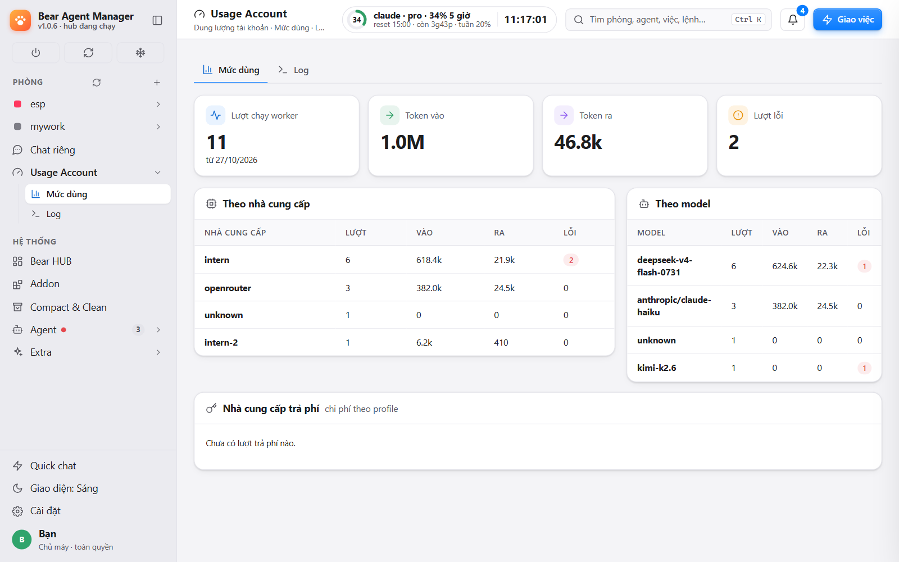
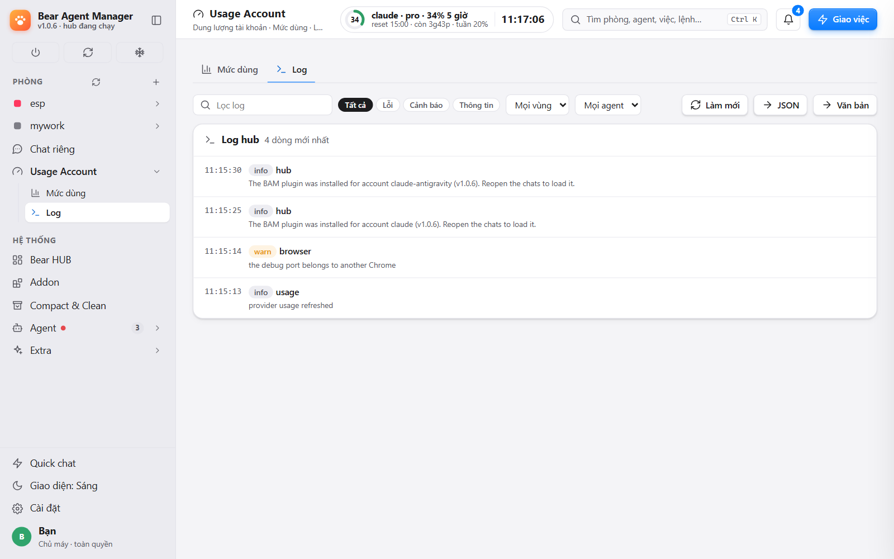

# Claude accounts

**English** · [Tiếng Việt](#tiếng-việt)

BAM treats every Claude config folder (`.claude`, `.claude-antigravity`, …) as an equal account. There is no "main" account and no administrator step.

## Add an account
**Settings › Accounts › Install Claude CLI** (a confirmation card goes to the room first), then **Add account and sign in**: a browser login. BAM never reads your tokens except to show usage (read-only).

## Usage
**Usage Account › Usage** shows the 5-hour and weekly limits per account. **Log** shows worker tokens and run history. Telegram `/list` shows the same numbers.

## When an account runs out
- A background wake can move to another account that still has room, if sharing is allowed in Settings.
- **Switch all** (app or Telegram `/switch`) moves every agent to the account you pick.
- A single agent can be moved between accounts from its card.

## Chats follow the agent
Chats live in BAM's own chat store; each account's `projects/` folder gets hard links to them. So an agent keeps its conversation when you move it to another account: no junctions, no UAC, no admin. (Design: #1025, `hub/chatstore.ts`.)

## Plugin and hooks
When BAM sees an account without its plugin, it installs it before starting an agent there (at most once an hour) and posts one line in the room if that fails. The plugin updates itself. Hooks carry a per-install token.

Source map: [`_features.md`](_features.md) section 4.

---

# Tiếng Việt

[English](#claude-accounts) · **Tiếng Việt**

BAM coi mỗi thư mục cấu hình Claude (`.claude`, `.claude-antigravity`, …) là một tài khoản ngang hàng. Không có tài khoản "chính" và không bước nào cần quyền admin.

## Thêm tài khoản
**Cài đặt › Tài khoản › Cài Claude CLI** (có thẻ xác nhận gửi vào phòng trước), rồi **Thêm tài khoản và đăng nhập**: đăng nhập qua trình duyệt. BAM không đọc token của bạn, trừ để hiện mức dùng (chỉ đọc).

## Mức dùng
**Usage Account › Mức dùng** hiện hạn mức 5 giờ và tuần của từng tài khoản. **Log** hiện token worker và lịch sử chạy. Lệnh Telegram `/list` cho cùng số liệu.

## Khi một tài khoản hết hạn mức
- Lượt đánh thức nền có thể chuyển sang tài khoản còn hạn mức, nếu Cài đặt cho phép dùng chung.
- **Đổi tất cả** (trong app hoặc Telegram `/switch`) chuyển mọi agent sang tài khoản bạn chọn.
- Từng agent cũng chuyển được giữa các tài khoản từ thẻ của nó.

## Chat đi theo agent
Chat nằm trong kho chat riêng của BAM; thư mục `projects/` của mỗi tài khoản chứa hardlink tới đó. Nhờ vậy agent giữ nguyên hội thoại khi chuyển tài khoản: không junction, không UAC, không admin. (Thiết kế: #1025, `hub/chatstore.ts`.)

## Plugin và hook
Khi BAM thấy tài khoản chưa có plugin, nó cài trước khi chạy agent ở đó (tối đa mỗi giờ một lần) và báo một dòng trong phòng nếu lỗi. Plugin tự cập nhật. Hook mang token riêng của mỗi lần cài.

Bản đồ nguồn: [`_features.md`](_features.md) mục 4.
