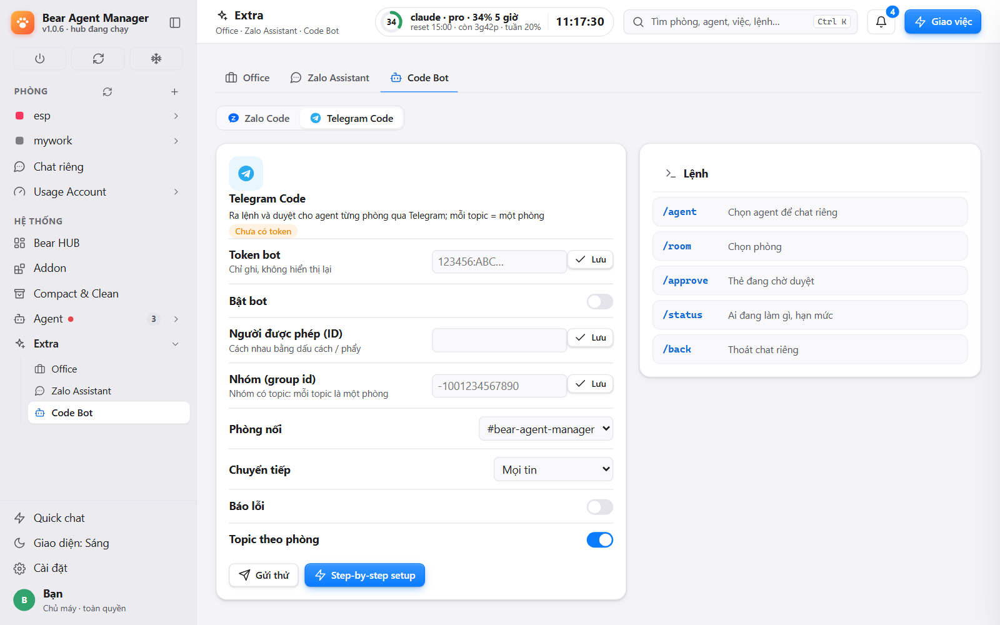
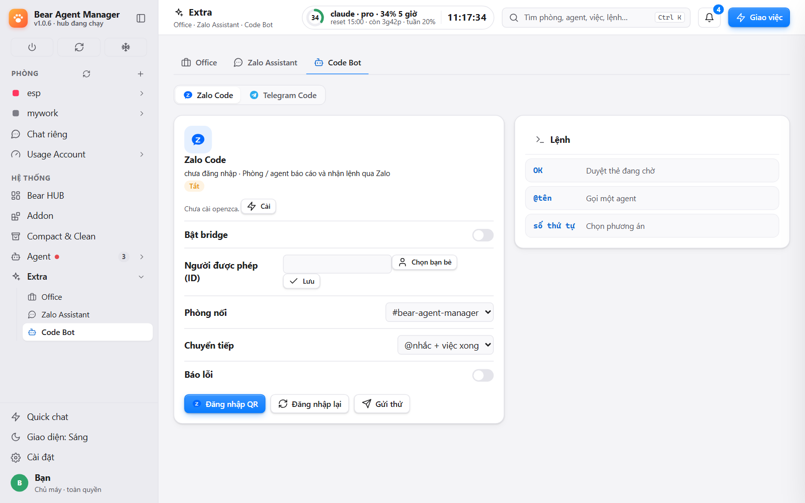

# Telegram & Zalo

**English** · [Tiếng Việt](#tiếng-việt)

Run BAM from your phone. Both channels are optional and off by default; set them up in **Settings › Zalo & Telegram**. Only the paired owner is answered; strangers are counted and ignored, never replied to.

## Set up Telegram
1. Create a bot with @BotFather and paste its token in Settings › Zalo & Telegram.
2. Pair: the setup window shows a 4-digit code; send `/start <code>` to the bot in a private chat (valid 10 minutes, 5 tries). You become the owner.
3. Optional group: make a supergroup with **Topics**, add the bot as admin (it needs to manage topics), send `/bam_id` in it. The id is saved for you.

## Private chat = bam-boss
Everything you type that is not a command goes to your private-chat agent (bam-boss, the system agent that leads every room). Tell it what you want; it creates the task and hands it to the right agent, and the answer comes back in the same chat.

| Command | Effect |
|---|---|
| `/start` | Button panel: status, tasks, accounts, freeze, wake, rooms, restart hub |
| `/status` | Busy / idle / off agents, usage of the pinned account, frozen rooms |
| `/tasks [room]` | Doing and blocked tasks of a room |
| `/freeze <room>`, `/unfreeze <room>` | Pause or resume a room, with a confirm card |
| `/wake <agent>` | Start an agent that is off or stopped by a limit (confirm first, uses usage) |
| `/list` | Claude accounts with 5-hour and weekly usage |
| `/switch` | Same list, one button per account; tap to move every agent to it |
| `/help` | Explains the buttons |
| 🔄 button | Restart the hub; asks first and defaults to cancel if agents are running; the bot says when the hub is back |

## Group with Topics = your rooms
One topic per room. Type in a topic to talk to that room. Photos and files (up to 20 MB) become attachments of the room.

| You type | Effect |
|---|---|
| `/rooms` or `#` | List rooms |
| `/topic <room>` | Create the topic for a room |
| `#room text` | Send to another room (outside topics); `#room` alone switches; `#?` shows where you are |
| `#12 1,3` | Answer question card number 12 by typing |

The **System** topic gets usage-limit, wake, error and restart notices. Topics receive your words, questions, answers to you, `@you` lines, ✅ task done and ❌ task error. Agent-to-agent chatter stays in the app.

## Approvals
- Question cards from agents are buttons; after you tap, the message shows ✅ with your choice.
- Risky words in a phone message (push, release, tag, delete, `rm -rf`, transfer, send e-mail, meeting invite) wait for `OK <4-digit code>` within 10 minutes; three wrong codes cancel it.
- An `@you` message nobody answers for 3 minutes makes the bot nudge you with `/switch` and `/wake` buttons.

## Files
You → agents: send a photo or document. Agents → you: the `telegram_send_file` tool (safe path check, Bot API size limit).

## Zalo

- **Zalo Code** (bot account): allowed senders, DMs and groups, talk to a room; `@you` and "done" lines are forwarded out and merged; agents send results or files back. Same `OK <code>` guard.
- **Zalo assistant** (your main account, read-only): stores messages locally for search, adds a daily summary to the morning brief, drafts follow-ups that wait for your Approve / Edit / Drop. It cannot send.
- Sign in by QR in Settings › Zalo; BAM installs the `openzca` CLI.

Source map: [`_features.md`](_features.md) section 5.

---

# Tiếng Việt

[English](#telegram--zalo) · **Tiếng Việt**

Điều khiển BAM từ điện thoại. Cả hai kênh đều tuỳ chọn, tắt sẵn; thiết lập ở **Cài đặt › Zalo & Telegram**. Chỉ chủ máy đã ghép nối được trả lời; người lạ chỉ bị đếm và bỏ qua, không nhận phản hồi.

## Thiết lập Telegram
1. Tạo bot bằng @BotFather, dán token vào Cài đặt › Zalo & Telegram.
2. Ghép nối: cửa sổ thiết lập hiện mã 4 số; nhắn `/start <mã>` cho bot ở chat riêng (hiệu lực 10 phút, thử 5 lần). Bạn thành chủ.
3. Nhóm (tuỳ chọn): tạo supergroup bật **Topics**, thêm bot làm admin (cần quyền quản lý topic), gõ `/bam_id` trong nhóm. ID được lưu giúp bạn.

## Chat riêng = bam-boss
Mọi chữ không phải lệnh được chuyển cho agent nhận chat riêng (bam-boss, agent hệ thống làm trưởng ở mọi phòng). Nói điều bạn muốn; nó tạo việc và giao đúng agent, kết quả trả về trong cùng chat.

| Lệnh | Tác dụng |
|---|---|
| `/start` | Bảng nút: trạng thái, việc, tài khoản, đóng băng, gọi dậy, phòng, khởi động lại hub |
| `/status` | Agent bận / rảnh / tắt, mức dùng tài khoản đang ghim, phòng đóng băng |
| `/tasks [phòng]` | Việc đang làm và bị chặn của một phòng |
| `/freeze <phòng>`, `/unfreeze <phòng>` | Tạm dừng hoặc mở lại phòng, có thẻ xác nhận |
| `/wake <agent>` | Bật agent đang tắt hoặc dừng vì hạn mức (hỏi trước, tốn hạn mức) |
| `/list` | Tài khoản Claude kèm hạn mức 5 giờ và tuần |
| `/switch` | Cùng danh sách, mỗi tài khoản một nút; bấm để chuyển cả đội sang đó |
| `/help` | Giải thích các nút |
| Nút 🔄 | Khởi động lại hub; hỏi trước, có agent đang chạy thì mặc định huỷ; bot báo khi hub đã lên lại |

## Nhóm có Topics = các phòng
Mỗi phòng một topic. Gõ trong topic là nói với phòng đó. Ảnh và tệp (tối đa 20 MB) thành tệp đính kèm của phòng.

| Bạn gõ | Tác dụng |
|---|---|
| `/rooms` hoặc `#` | Liệt kê phòng |
| `/topic <phòng>` | Tạo topic cho phòng |
| `#phòng nội dung` | Gửi sang phòng khác (ngoài topic); `#phòng` một mình = chuyển; `#?` = đang ở đâu |
| `#12 1,3` | Trả lời thẻ hỏi số 12 bằng cách gõ |

Topic **Hệ thống** nhận thông báo hạn mức, gọi dậy, lỗi, khởi động lại. Topic phòng nhận lời bạn, câu hỏi, câu trả lời cho bạn, dòng `@you`, ✅ việc xong, ❌ việc lỗi. Agent nói chuyện với nhau thì ở lại trong app.

## Duyệt
- Thẻ hỏi của agent là nút bấm; bấm xong tin hiện ✅ kèm lựa chọn.
- Tin có từ rủi ro (push, release, tag, xoá, `rm -rf`, chuyển tiền, gửi e-mail, mời họp) bị giữ đến khi bạn trả lời `OK <mã 4 số>` trong 10 phút; sai 3 lần thì huỷ.
- Tin `@you` không ai trả lời sau 3 phút: bot nhắc kèm nút `/switch` và `/wake`.

## Tệp
Bạn → agent: gửi ảnh hoặc tài liệu. Agent → bạn: tool `telegram_send_file` (kiểm đường dẫn an toàn, theo giới hạn dung lượng của Bot API).

## Zalo

- **Zalo Code** (tài khoản bot): người gửi được phép, tin riêng và nhóm, nói với phòng; dòng `@you` và "xong" được chuyển ra và gộp; agent gửi kết quả hoặc file lại. Cùng cơ chế `OK <mã>`.
- **Zalo trợ lý** (tài khoản chính, chỉ đọc): lưu tin cục bộ để tìm, thêm tóm tắt cuối ngày vào bản tin buổi sáng, nháp việc cần theo dõi chờ bạn Duyệt / Sửa hạn / Bỏ. Không gửi được tin.
- Đăng nhập bằng QR ở Cài đặt › Zalo; BAM tự cài CLI `openzca`.

Bản đồ nguồn: [`_features.md`](_features.md) mục 5.
